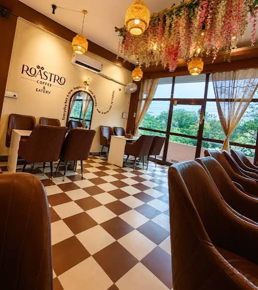

# Roastro Coffee House ☕

A premium, editorial luxury website for **Roastro Coffee House** in Alwar, Rajasthan, inspired by the hospitality design language of [Four Fathers](https://www.fourfathers.co/).



## 📍 Business Information
- **Business**: Roastro Coffee House (Coffee House & Café)
- **Address**: 1st Floor, Shri Ram Market, 11, Near Wonder Mall, Alwar, Rajasthan 301001, India.
- **Contact**: [+91 95091 51498](tel:+919509151498)
- **Timings**: Monday – Sunday: 10:00 AM – 11:00 PM

---

## ✨ Features
1. **Editorial Luxury Navigation**: Sticky frosted glass navbar with official brand emblem, spacious link hierarchy, and dual action CTAs.
2. **Photographic Hero**: Full-bleed composition featuring authentic Roastro interior photography with refined typography.
3. **About Roastro**: Two-column layout showcasing the botanical wisteria canopy, barista espresso station, and authentic wall motto.
4. **Why Visit Roastro**: Four-item numbered editorial cards (`01` through `04`) for coffee quality, refreshing creations, warm atmosphere, and tabletop games.
5. **Signature Drinks Showcase**: Interactive tasting notes spotlight for all 9 signature cold brews, lattes, and cold foam creations.
6. **Complete Handcrafted Menu**: Real-time category filtering (Black Coffee, White Coffee, Signature Drinks, Mocktails) and instant search.
7. **Authentic Menu Card Viewer**: High-resolution modal viewer for the original in-house printed menu cards.
8. **Guest Experiences**: Testimonials and reviews section celebrating relaxed afternoons, board games, and friend catch-ups.
9. **Café Gallery & Lightbox**: Asymmetric masonry grid featuring authentic photos with keyboard-controlled fullscreen zoom lightbox.
10. **Location & Contact**: Interactive Google Map integration, direct calling (`tel:`), directions link, and table visit inquiry form.
11. **Mobile Quick Action Bar**: Floating bottom bar with instant Call, Directions, and Visit Reservation buttons.

---

## 🛠️ Tech Stack
- **Framework**: React 19 + TypeScript
- **Styling**: Tailwind CSS 3.4
- **Build Tool**: Vite 5
- **Icons**: Lucide React
- **Animations**: Framer Motion & CSS transitions

---

## 🚀 Getting Started

### Prerequisites
- Node.js (v18+)
- npm or pnpm

### Installation
```bash
# Clone the repository
git clone https://github.com/nainadarey-ctrl/roastro-coffee-house.git

# Navigate to project directory
cd roastro-coffee-house

# Install dependencies
npm install

# Start local development server
npm run dev
```

### Production Build
```bash
npm run build
npm run preview
```

---

## 📄 License
© 2026 Roastro Coffee House. All rights reserved.
